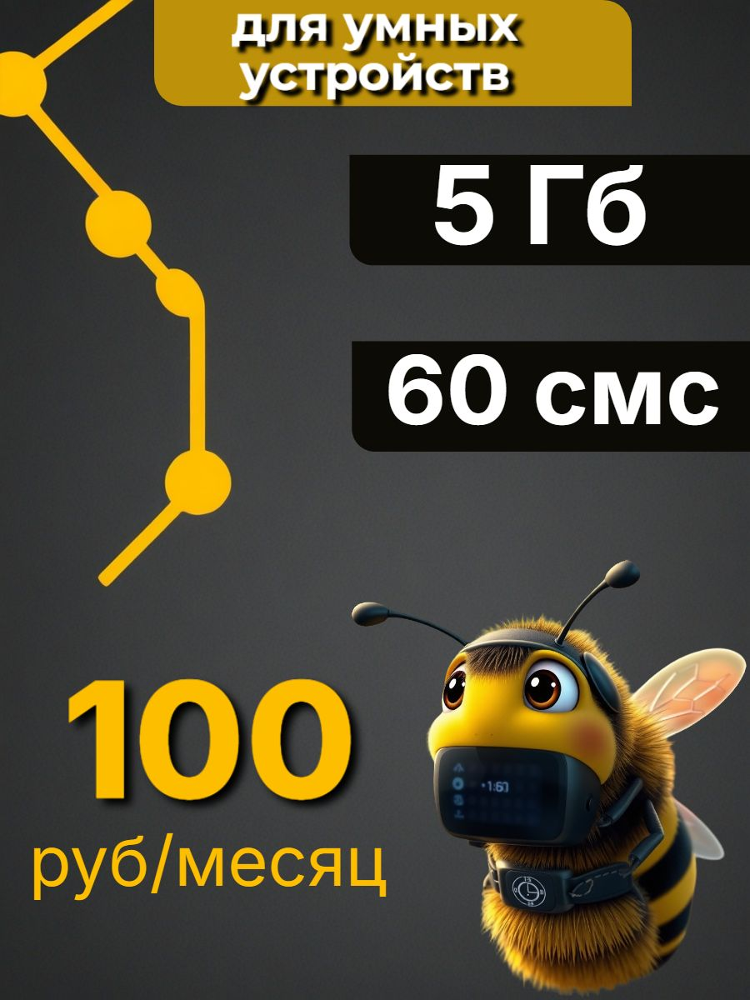
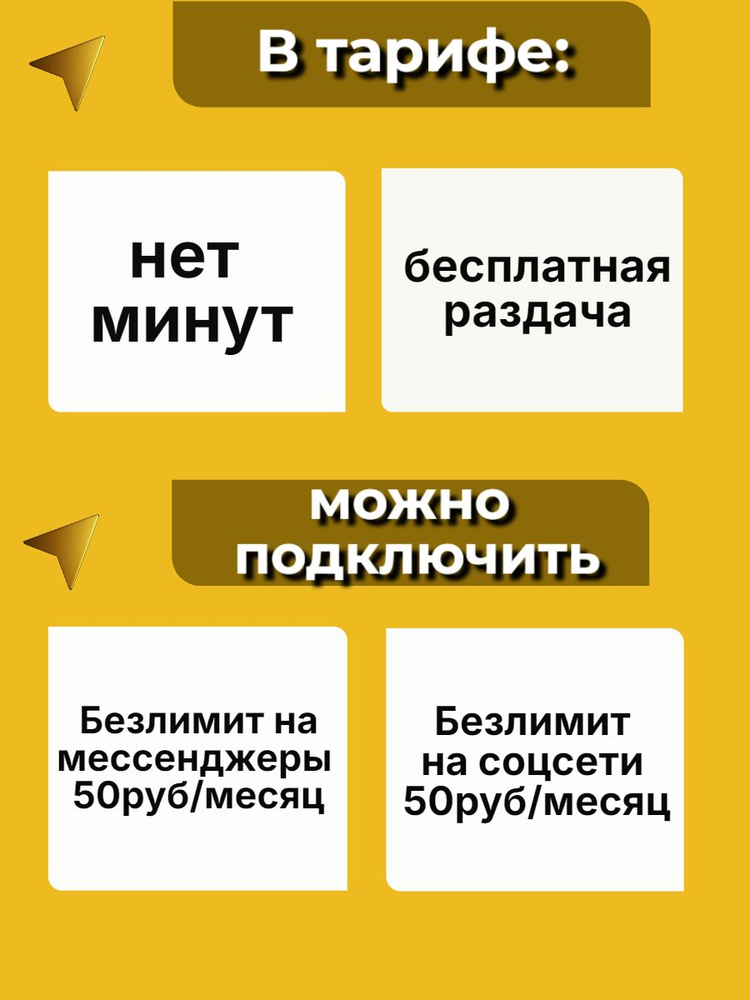
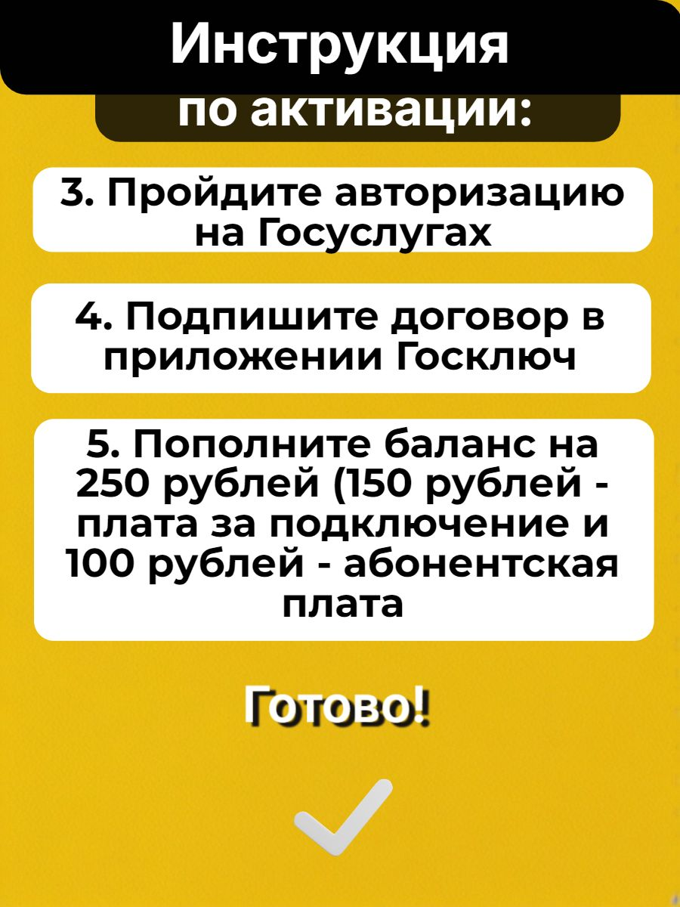

# Малый пакет для умного устройства: полный разбор Билайна у «Много Сим»

## Выбор методов и статус результата

Выбраны соответствие функции устройства, денежные отношения, прагматика обещания, смысловой перенос, композиция, когнитивные операции и конец использования. Их выход — восстановленное предложение, поддержанные прочтения, ранняя структура выбора и исполнимая последовательность. Ранг коммерческого эффекта и межплощадочное сравнение здесь не требуются. Оговорки о текущих условиях относятся размещению, а рабочий экспертный вывод принимается по источникам.

[Все разборы и маршруты](../ОТКРЫТЬ.html)

## Что продаётся и какое решение предлагается

Рассматривается карточка Ozon 3145077393: SIM Билайна с 5 ГБ, 60 SMS и платой 100 рублей в месяц у продавца «Много Сим». Для этой работы передан комплект из 30 файлов, включая 14 изображений галереи и магазинный баннер. Дата и регион самого наблюдения неизвестны. Число «2» в файле цены не имеет собственной денежной единицы. Это не позволяет без условия утверждать, что покупка вместе с пополнением стоит 252 рубля.

Основной резерв продажи состоит в переходе от универсального обещания «работает во всех устройствах» к понятному выбору под конкретную функцию. У предложения есть сильное ядро: небольшой пакет, низкая заявленная регулярная плата и использование в оборудовании. Но пригодность зависит от потребления, голосовой функции, сети и регистрации. Полезный результат здесь не заканчивается заказом пластика: устройство должно передать нужные данные или сообщение.

Рекомендуется сохранить выразительный главный кадр и конкретные ресурсы, раньше объяснить деньги запуска и предложить короткий путь проверки задачи. Модель помощи при настройке может стать самостоятельной причиной выбрать магазин, если продавец подтвердит её содержание и способность исполнить. Ни реакция покупателей, ни дополнительный эффект этих изменений пока не измерены.

## Как восстановлено предложение

В [описании](../sources/3145077393/description.txt) указаны 5 ГБ без ограничения скорости, бесплатная раздача, 60 SMS и «нет звонков». Безлимитные мессенджеры и соцсети названы отдельными опциями по 50 рублей в месяц. Нельзя объединять их с базовым пакетом или превращать бесплатную раздачу в неограниченный объём интернета.

В описании перечислены варианты 5, 10, 15 и 30 ГБ. Собственные цены остальных вариантов и работающий выбор не предоставлены. Поэтому «выберите любой объём за 100 рублей» было бы новым обещанием. В [характеристиках](../sources/3145077393/characteristics.txt) стартовый баланс равен нулю. Это состояние при покупке, а не запрет на последующее пополнение.

На [кадре 13](../sources/3145077393/Gallery/G13.jpg) пополнение составляет 250 рублей: внутри него 150 за подключение и 100 абонентской платы. Это одна сумма с двумя частями, а не три доплаты. Источник не устанавливает здесь точную границу первого оплаченного периода. Следовательно, в готовом тексте нельзя самовольно заменить «абонентская плата» на «первый месяц». На [кадре 6](../sources/3145077393/Gallery/G06.jpg) дан порядок «после активации»; описание дополнительно требует сначала активировать SIM в смартфоне или планшете перед использованием в оборудовании.

Голосовую пригодность нужно раскрыть отдельно. «Нет минут» на кадре 3 означает отсутствие пакета минут; «нет звонков» в описании относится к функции. Это не равнозначные утверждения. До подтверждения действительного режима предложение следует ориентировать на задачи, которым достаточно данных и SMS. Нельзя включать в готовую рекомендацию часы для обязательных голосовых звонков, опираясь только на слово «часы» в перечне.

## Главный кадр: почему персонаж здесь делает больше, чем украшает

Вверху написано «Для умных устройств». Справа на тёмных плашках размещены 5 ГБ и 60 SMS; слева внизу крупное жёлтое 100 и подпись «руб/месяц». Нижнюю правую область занимает пчела: полосатое тело, крылья, усики, большие глаза, электронное оснащение у лица и шеи. Слева проходят жёлтые линии с круглыми узлами. Название оператора словами внутри этого кадра не напечатано.

Сначала здесь работает узнавание цветового кода: чёрно-жёлтые полосы персонажа повторяют палитру остальных элементов и связаны с образом Билайна в других кадрах. Это связь по оформлению, а не самостоятельное доказательство бренда или полномочий продавца. Геометрические узлы задают тему соединённых устройств, но не изображают проверенную архитектуру сети.

Следующий слой создаёт гибрид живого и технического. Обычная пчела не носит электронного оснащения; такое соединение позволяет представить небольшое «умное» устройство через персонажа. Надпись закрепляет нужную область: речь идёт о технике, а ресурсы переводят образ в предметное предложение. Персонаж способен выполнять функцию опознаваемого посредника между абстрактной SIM и оборудованием, которому нужна связь.

Более дальние прочтения, например забота, трудолюбие, самостоятельность или надёжность, слабее. Пчела действительно допускает такие культурные ассоциации, но в этом кадре не показаны обслуживание устройства, защита от сбоя или выполненная работа. Большие глаза и округлые формы можно описать; положительную эмоцию аудитории по ним установить нельзя. Альтернатива сложной метафоре состоит в фирменном персонаже и декоративном технологическом оформлении. Она не отменяет полезность изображения, но ограничивает обещания, которые можно ему приписать.

Мысленная замена помогает выбрать действие. Если оставить числа и заменить пчелу нейтральным роутером, продуктовые сведения сохранятся, но исчезнут персонаж и цветовая игра бренда. Если убрать слова и числа, пчела не сообщит объём пакета, цену или способ регистрации. Следовательно, её функция поддерживающая: узнавание и представление категории. Убирать персонажа только ради более «делового» вида не обоснованно. Для продажи конкретного применения можно добавить рядом понятную задачу, сохранив персонажа вторым центром.

## Рекламный диалог: сильное снятие возражения и слишком широкая область

[Кадр 2](../sources/3145077393/Gallery/G02.jpg) спрашивает об автосигнализации, [кадр 4](../sources/3145077393/Gallery/G04.jpg) о часах и котлах. Оба отвечают: «Да! Работает во всех устройствах». Это не просто перечень совместимости. Разговорное «А в… работает?» представляет реплику покупателя; крупное «Да!» принимает роль уверенного ответа магазина. Так карточка пытается снять сомнение до перехода к условиям.

Тёмная фактура кадра 2 похожа на поверхность обивки, что уместно связывает вопрос с автомобильной темой. Однако та же фактура повторяется у часов и котлов: во втором случае сильнее видна функция общего шаблона, чем предметного окружения. Фактура сама не даёт сведений о функции SIM.

Содержательная проблема находится в переходе от частного вопроса к всеобщему ответу. Категория устройства не определяет требуемую операцию: одним часам достаточно данных, другим нужны звонки; одной камере хватает редких сообщений, другой требуется потоковое видео. Поэтому перечень на [кадре 5](../sources/3145077393/Gallery/G05.jpg) расширяет узнаваемость применения, но не устанавливает пригодность каждой модели.

Усиление должно сохранить диалог и заменить логику ответа. Проект сообщения: «Нужны данные и SMS для устройства? Проверьте его модель, необходимую функцию и расход. В этом варианте 5 ГБ и 60 SMS за 100 рублей в месяц». Это подготовительный текст, требующий подтверждения действующих условий; он не обещает автоматическую проверку, которой в канале пока нет. Для выбора конкретной модели магазин может предложить консультацию, если организует такой процесс.

## База, дополнения и слово «безлимит»

Две верхние белые плитки находятся под «В тарифе», две нижние под «Можно подключить». Это полезная пространственная граница базы и опций. В то же время все четыре плитки имеют близкую форму и фон. Если потеряется заголовок группы, дополнение по 50 рублей может выглядеть ещё одной включённой характеристикой. Решение состоит в сохранении не только цвета, но и явного статуса: «Включено» и «По желанию, отдельно по 50 рублей в месяц».

[Кадр 7](../sources/3145077393/Gallery/G07.jpg) говорит: «Раздача безлимитная бесплатная». По своему вопросу это ответ о режиме раздачи, но слово «безлимитная» допускает расширение на весь интернет. Описание ограничивает базовый объём пятью гигабайтами. Поэтому сильный точный аргумент: «Раздавайте включённые 5 ГБ без отдельной платы». Если у продукта действительно нет дополнительных ограничений раздачи, их можно раскрыть отдельно; это не основание обещать неограниченный трафик.

## География и номер: какие решения нельзя принимать по одному заголовку

[Кадр 8](../sources/3145077393/Gallery/G08.jpg) отвечает на вопрос о регионе крупным «по всей России», затем сохраняет исключения отдельным нижним блоком. По структуре это часть одного ответа. Переносить верхнюю строку без исключений в будущий макет нельзя. Определение «новых регионов» в полученном материале не раскрыто; оно не заполняется догадкой. [Кадр 9](../sources/3145077393/Gallery/G09.jpg) предлагает карту покрытия. Он полезен как следующий способ проверки, но не показывает реальный сигнал внутри помещения.

Кадр 6 утверждает возможность переноса своего номера от другого оператора и показывает экран выбора красивого номера. На кадре 11 написано «Переход невозможен. Сим-карта только для новых подключений». Описание отдельно разрешает переход от другого оператора и запрещает смену на другой тариф линейки. Возможно, речь идёт о разных предметах перехода, но источник не разрешает это окончательно. Готовый экран телефона не подтверждает доступность нарисованного номера при заказе. До уточнения нужно сохранить отдельные ветви и не делать перенос главным аргументом версии.

## Композиция и когнитивная работа до покупки

Главный кадр имеет три разных центра: назначение сверху, ресурсы справа и цена внизу слева. Ресурсы хорошо отделены от фона, а период стоит рядом с суммой. Это поддерживает сравнение небольшого пакета. Но начальное пополнение находится только в поздней инструкции. Чтобы определить деньги запуска, человеку требуется перейти к кадру 13, удержать отличие месячной услуги от подключения и отдельно добавить цену покупки при известной единице. Такую необходимость можно установить по структуре; сколько людей реально выполняют её или ошибаются, неизвестно.

Предложение не состоит в добавлении всех условий на первый кадр. Нужен ранний связанный блок: ресурс и период; пригодная задача; пополнение 250 рублей как общая сумма с вложенными частями; отдельно цена носителя; короткий вход к подготовке регистрации. Внутренние 150 и 100 нельзя показать как три равноправные ценовые плашки вместе с 250. Это вопрос логической вложенности, а не только шрифта.

В [кадре 10](../sources/3145077393/Gallery/G10.jpg) перечислены интернет, Госуслуги для граждан РФ 18+, Госключ и отключение VPN при его наличии. Визуальные галочки оформляют список подготовки, но не подтверждают готовность человека. Условное отключение VPN нельзя превратить в безусловный отдельный барьер. Такой блок нужен до решения о покупке, поскольку один призыв «активируйте» не создаёт недостающие средства.

## Инструкция и образ завершения

Кадры 12–13 дают нумерацию действий: приложение, следование рекомендациям, авторизация, подпись, пополнение. Последовательная нумерация помогает сохранять место. Слово «Готово!» и большая галочка после денежного шага создают визуальный конец. Но окончание регистрации в смартфоне не устанавливает работу конечного устройства. В предоставленном описании SIM ещё нужно использовать в оборудовании; его настройка и проверка полезной функции не показаны.

Здесь пригодны когнитивная эргономика и работа с прогрессом. Разделите «договор оформлен и счёт пополнен» и «устройство работает». Добавьте только реально поддерживаемые шаги: проверить нужный пакет, установить и настроить SIM по инструкции модели, выполнить согласованное полезное действие. Если магазин не ведёт настройку, не обещайте его участие. Вместо общей галочки нужен результат названного этапа и понятный переход.

[Кадр 14](../sources/3145077393/Gallery/G14.jpg) уже лучше неопределённого «поддержка поможет»: текст называет чат, а красная стрелка указывает серый плюс на снимке экрана. Гарнитуры или улыбки здесь нет; смысл несёт предметная инструкция. Но экран содержит дату 2024 года, которая не является датой всего комплекта. Доступность сегодняшнего пути обращения не проверена. Перед применением обновляют реальный путь и сообщают, что указать в обращении: модель, этап и безопасное описание затруднения, без лишних персональных данных.

## Магазинный баннер: другое сообщение внутри той же карточки

В баннере показаны разнооператорские SIM, телефон с 5G, часы, оборудование и галочки возле безлимитного интернета, SIM для устройств и помощи при активации. Веер SIM представляет ассортимент; телефон и часы заменяют широкий класс применений; галочки оформляют подтверждающий список. Это три разные операции, а не одна универсальная метафора.

Возможно корректное прочтение: магазин продаёт несколько операторов и типов пакетов. Возможно и расширенное: все перечисленные свойства относятся к выбранным 5 ГБ. Внутри карточки граница не дана самим веером. Поэтому нужно подписать «Ассортимент магазина» и вернуть рядом собственные условия выбранного варианта. Фактическая поддержка 5G этой SIM не установлена баннером. Большие белые поля уменьшают долю баннера в исходном файле; это наблюдаемая геометрия, но не измеренная потеря читаемости на настоящем телефоне.

## Приоритеты управления продажей

Первое изменение: ранняя пригодность и деньги. Оно должно сделать привлекательный малый пакет понятным подходящему покупателю и дать основание отказаться неподходящему. Ожидаемое событие не только заказ, но оплаченная, полученная и работающая SIM в подходящей задаче. Встречный эффект: ранняя общая сумма может уменьшить импульсный интерес. Поэтому клики и заказы нельзя оценивать без возвратов, завершения настройки и денежных результатов продавца.

Второе изменение: завершение пути использования. Инструкция после получения не получает заслугу за предшествующую оплату. Её сравнивают по активации, полезной работе, поддержке и продолжению на заранее ограниченном горизонте. Стоимость помощи входит в экономику продавца; операторский взнос не становится его доходом автоматически.

Третье изменение: сервисная модель «подберём и доведём до функции». Она может отличить магазин от продажи одного носителя. Это уже проект исполнения: нужны поддерживаемые устройства, границы консультации, доступный путь и стоимость. Пока этих оснований нет, допустим проект, а не рекламная гарантия.

В коммерческом отчёте строка 457 содержит 497 заказанных единиц, 126247 показов и 2655 переходов за обозначенные источником 28 дней, семь дней отсутствия на складе. Эти данные позволяют описать результат строки, но не связывают его с пчелой или порядком кадров. Оплаты, активации и маржа не предоставлены. Общий вывод остаётся экспертным: сохранить конкретность и узнаваемость, перестроить ранний выбор и завершение, затем проверять полезную продажу при подтверждённых условиях.

## Полнота рассмотренного комплекта

Все 15 изображений разобраны по собственной функции: главный пакет; два диалоговых вопроса; база и опции; перечень применений; номер; раздача; территория; покрытие; подготовка; ограничения; две части инструкции; помощь; магазинный ассортимент. Текстовые поля прочитаны вместе с ними. Рейтинг 4,8 и 718 отзывов не превращены в 718 успешных активаций; наличие по сохранённому полю не объявлено текущим. Визуальный состав, семантика и выводы раскрыты выше; число учтённых файлов не служит самостоятельным доказательством глубины.
