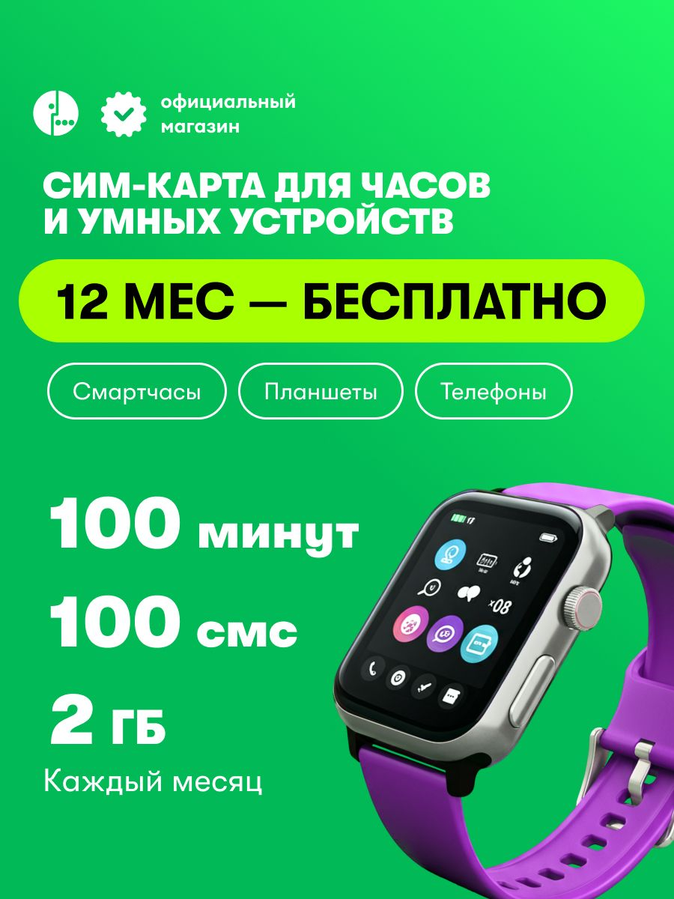
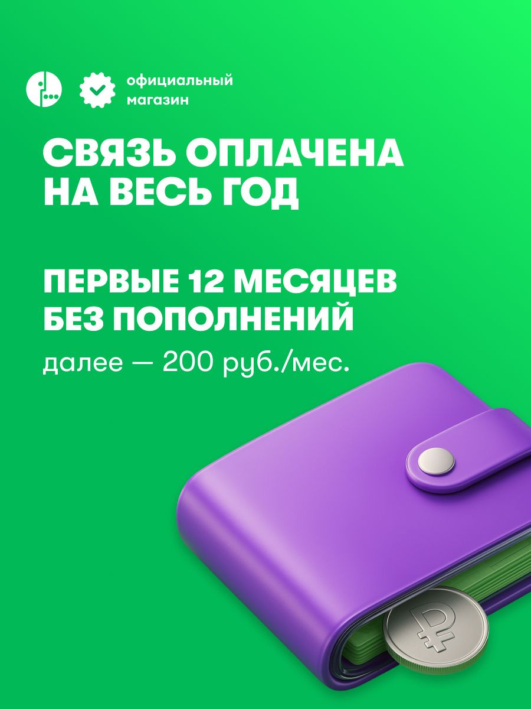

# Включённый год связи: как продавать предсказуемость без подмены смысла

## Выбор методов и статус результата

Выбраны связь характеристики с выгодой, денежный горизонт, область бесплатности, совместное значение текста и предмета, группировка условий и продолжение. Результат — два пригодных направления подачи и собственные ограничения периода. Экономия на всём рынке и реакция покупателей не назначаются; это не задерживает принятие экспертной модели включённого года.

[Все разборы и маршруты](../%D0%9E%D0%A2%D0%9A%D0%A0%D0%AB%D0%A2%D0%AC.md)

## Предложение и коммерческий вывод

Карточка Ozon 3044399427 у продавца с отображаемым именем «МегаФон» предлагает SIM для устройств с оплаченными первыми 12 месяцами: каждый месяц 2 ГБ, 100 минут и 100 SMS; далее 200 рублей в месяц. В сохранённом наблюдении от 25 сентября 2026 года цена покупки составляет 750 рублей, валюта подтверждена собственными данными комплекта. Изучены все 25 файлов, включая восемь изображений. Это архивное предложение, а не проверка сегодняшнего тарифа.

Сильная модель здесь отличается от продажи низкой месячной ставки. Покупателю предлагают заранее обеспечить связь и не пополнять счёт ежемесячно в течение включённого периода. Для часов, второго устройства или техники с предсказуемым расходом такая организация может быть самостоятельной ценностью. Размер и распространённость этого спроса из рекламы не установлены.

Рекомендуется сохранить год как главный аргумент, связать его с платной покупкой и ежемесячным ресурсом, а затем ясно объяснить переход к следующей фазе. Не нужно превращать карточку в ещё одно предложение «дешевле в месяц», если исходная ценность состоит в отсутствии регулярного действия. Но преимущество должно оставаться ограниченным собственным ресурсом, подготовкой регистрации и реальной пригодностью устройства.

## Что делает слово «бесплатно»

На первом кадре верхний текст задаёт SIM для часов и устройств. Ниже яркая горизонтальная плашка «12 МЕС — БЕСПЛАТНО», под ней три обозначения категорий: смарт-часы, планшеты, телефоны. В левой части перечислены 100 минут, 100 SMS и 2 ГБ; возле последней строки стоит «Каждый месяц». Справа крупно показаны часы с фиолетовым ремешком и экраном приложений.

Логика сообщения начинается с временной выгоды. Число 12 и слово «бесплатно» собраны в один яркий блок и сильнее выделены, чем условия пользования. Изображение часов выполняет предметную функцию: показывает класс техники, для которого предлагается связь. Оно не устанавливает, что часы входят в комплект, что показанная модель проверена или что приложение на их экране будет доступно после активации.

«Бесплатно» здесь требует восстановления предмета. В [описании](../sources/3044399427/description.txt) названы оплаченный тариф и первые 12 месяцев без пополнений. Цена покупки 750 рублей относится к комплекту. Следовательно, точная ценность состоит в включённой связи за оплаченный горизонт, а не в бесплатном получении SIM или неограниченном пользовании. Без этого перехода читатель вынужден самостоятельно решать, почему бесплатный год продаётся за деньги.

Сильный проект формулировки: «Связь на первые 12 месяцев включена в стоимость комплекта. Каждый месяц: 2 ГБ, 100 минут и 100 SMS. В сохранённом предложении комплект стоит 750 рублей; далее 200 рублей в месяц». Для будущего размещения действующая цена и условия подтверждаются заново. Такой текст сохраняет годовой аргумент и не превращает его в бесплатную покупку.

Важна область «каждый месяц». Это не 2 ГБ на весь год и не годовой безлимит. Стоящая возле списка подпись получает объяснение в основном тексте, а не только в справочной части. Возможное уменьшение впечатления бесплатности является встречным эффектом новой подачи; его нельзя заранее объявить коммерчески полезным или вредным без сравнения подходящих покупок.

## Кошелёк: что именно обозначает денежный образ

Крупный заголовок сообщает «Связь оплачена на весь год», следующий блок «Первые 12 месяцев без пополнений», затем меньшая строка «далее — 200 руб/мес». Нижнюю половину занимает закрытый фиолетовый кошелёк; возле него видна монета со знаком рубля. Цвет предмета повторяет ремешок часов и другие акценты галереи.

Буквальный предмет принадлежит денежной сфере. Он может представлять оплату по связи с действием, то есть работать как метонимия. Связка закрытого кошелька и отсутствия пополнений допускает дополнительное прочтение: не нужно регулярно доставать деньги или возвращаться к платежу. Оно сильнее общего толкования «экономия», потому что подпись прямо говорит о действии пополнения. Величина экономии на этом кадре не показана.

Альтернатива состоит в стандартной иллюстрации финансового условия без отдельного смысла закрытости. Её нельзя исключить; поэтому не следует объявлять замкнутый кошелёк доказанной метафорой спокойствия. Тем более изображение не показывает возврат денег, денежный подарок или фактический остаток покупателя. Число 1751 в [характеристиках](../sources/3044399427/characteristics.txt) относится к стартовому балансу; его нельзя вычесть из 750 как возвращаемые наличные.

Композиция сохраняет две фазы в одном кадре, что является сильной практикой. Но по весу они различаются: крупный год и большой кошелёк доминируют над последующим месячным условием. Решение состоит в общей временной схеме «при покупке → первые 12 месяцев → затем», где граница фазы остаётся различимой. Не нужно делать все элементы одинаковыми: преимущество может быть главным, если последующее обязательство доступно и связано с ним.

## Щит с замком: более широкий образ, чем названная защита

На [кадре 4](../sources/3044399427/Gallery/G04.jpg) заголовок «Защита — это важно», затем названы спам, мошенники и нежелательные подписки. Внизу большой прозрачный фиолетовый щит с навесным замком. Щит предлагает отношение преграды, замок ограничение доступа; объединение двух знакомых знаков усиливает общий смысл защищённости. Глянцевый объём связывает предмет с остальными иллюстрациями.

Эти операции не одинаковы. Сам щит уже является условным знаком защиты; перенос физической преграды на цифровую услугу может поддерживаться контекстом. Замок дополнительно сужает доступ. Но на изображении нет конкретного взаимодействия угрозы и преграды, поэтому развёрнутый сюжет «мошенник остановлен» был бы добавлением аналитика. Текст ограничивает предмет; его необходимо сохранять рядом с образом.

Для использования в часах возможен побочный широкий смысл: защита самого ребёнка, устройства или местонахождения. Рекламный материал этого не устанавливает. Такой риск прочтения не означает, что все покупатели так понимают щит. Он задаёт точное требование редактору: назвать действительный механизм услуги и не подменять его обещанием безопасности человека. Если механизм действительно состоит в запросе подтверждения подписки, его следует показать как процесс, а не только как ещё один знак доверия; для этой годовой SIM он требует собственной опоры.

## Подготовка и активация: композиция должна передать логику условий

[Кадр 3](../sources/3044399427/Gallery/G03.jpg) показывает четыре примера техники в одинаковых плитках. Здесь равенство формы уместно: все плитки представляют категории применения. Заголовок «на всех устройствах» шире этих примеров; достаточность 2 ГБ, частоты и голосовой функции остаётся отдельным вопросом конкретной модели.

На [кадре 5](../sources/3044399427/Gallery/G05.jpg) та же логика сетки используется иначе: четыре номера подписывают Госуслуги, Госключ, «Или подтверждённый номер МегаФона» и смартфон с интернетом. Цифры предлагают чтение как общий список или порядок действий, но «или» относится к альтернативному способу подтверждения. Смартфон является общей технической предпосылкой, а не альтернативой Госключу. Это содержательное напряжение группировки и логики.

На [кадре 6](../sources/3044399427/Gallery/G06.jpg) ветви раскрыты яснее: действующий номер абонента либо Госуслуги с Госключом. Здесь уже есть нумерованная вертикальная последовательность, выбор региона, номера и тарифа. Но годовой комплект продаётся с включённым конкретным наполнением. Покупатель должен понимать, как выбор на экране связан с сохранением именно этого предложения. Реальный интерфейс и доступность показанных ветвей не предоставлены.

Предлагаемая организация: сначала общая подготовка, затем две подписанные ветви идентификации, затем результат подтверждения своего комплекта. Возраст 14+ и гражданство РФ на кадре 5 сохраняются как условия источника; они не переносятся из другого оператора или на все способы подключения без проверки. Нельзя принять краткое «активация в один клик» по декоративному изображению SIM и переключателя на кадре 6.

## Помощь, авторитет и направление поведения

[Кадр 7](../sources/3044399427/Gallery/G07.jpg) перечисляет проблемы доставки и товара, затем просит написать в поддержку перед отзывом. Гарнитура с речевым облаком представляет обслуживание; белая плашка выделяет предлагаемый порядок действия. Это реальный приём направления поведения в сообщении: затруднение → обращение → возможное решение. Он может обслуживать восстановление продажи и управление отзывами одновременно. Из него нельзя установить, что магазин отвечает быстрее, действительно устраняет проблему или не допускает отрицательных оценок.

[Кадр 8](../sources/3044399427/Gallery/G08.jpg) завершает галерею названием официального магазина и обещанием помощи «всегда» и по «любым вопросам». Большая объёмная эмблема повторяет брендовый знак. Смысл авторитета поддерживается повтором логотипа, значком с галочкой и словом «официальный». Это наблюдаемое утверждение источника; юридическая связь, объём полномочия и способность выполнить универсальное обещание не доказаны этими же знаками.

Усилить можно не число эмблем, а предметность поддержки: какие ситуации она разбирает, какой шаг доступен, что считать восстановленным результатом. Неизвестный срок ответа остаётся неизвестным. В качестве рабочего проекта допустимо описать процесс; как гарантию его можно использовать после подтверждения исполнения.

## Мотивация, усилие и варианты усиления

Здесь есть три разных пути влияния. Первый усиливает ценность: заранее оплаченный горизонт уменьшает число будущих действий по пополнению при подходящем потреблении. Второй уменьшает усилие понимания: временная схема связывает стоимость покупки, включённые ресурсы и следующую плату. Третий поддерживает исполнение: ясная подготовка и подтверждение нужного пакета перед завершением.

Вариант А сохраняет ресурсное начало: часы, месячное наполнение, включённые 12 месяцев. Он подходит задаче выбора функции и объёма. Вариант Б начинает с предсказуемости: одна покупка комплекта, первые 12 месяцев без пополнений, ежемесячное наполнение и затем 200 рублей. Он делает главным денежный горизонт. У обоих вариантов одинаковые подтверждённые условия; выбор не решается эстетическим предпочтением.

Послепокупочное сопровождение может напомнить о завершении настройки и приближении конца включённого периода. Это проект своевременной помощи, а не установленное удержание. Напоминание о следующей плате должно опираться на реальное начало периода и доступное право коммуникации; такой сервис в материалах не подтверждён. Его не следует выдавать за уже работающую функцию продавца.

## Как оценивать продажу и что пока неизвестно

Для этого SKU в предоставленной таблице нет сопоставленной строки продаж. Это пробел, а не ноль и не основание объявлять годовую модель неуспешной. Маржа продавца, операторское вознаграждение, возвраты и длительное использование неизвестны. Цена 750 рублей не является прибылью; баланс 1751 не является возвратом.

Нельзя сравнить годовой комплект с 5 ГБ Билайна как два полностью одинаковых продукта: различаются объём, минуты и денежная фаза. Допустим контраст моделей и условный расчёт на общем горизонте с явными предпосылками. Для внедрения важнее проверить собственную пригодность, завершённые оплаченные подключения и расходы сопровождения. Все восемь изображений рассмотрены: продукт, денежная фаза, техника, защита, подготовка, активация, восстановление и авторитет. Их целостный смысл состоит в предсказуемой связи для подходящего устройства, а не в универсально бесплатной и защищённой услуге.
