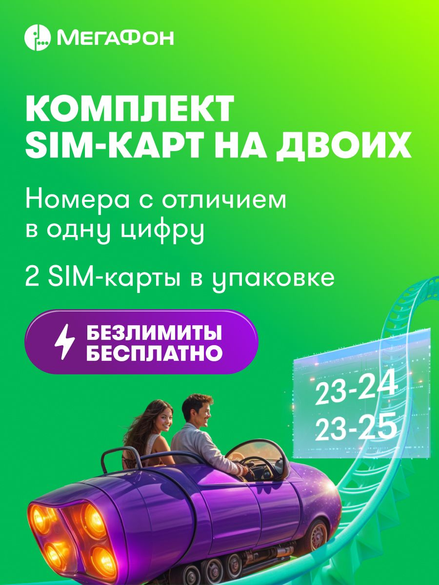
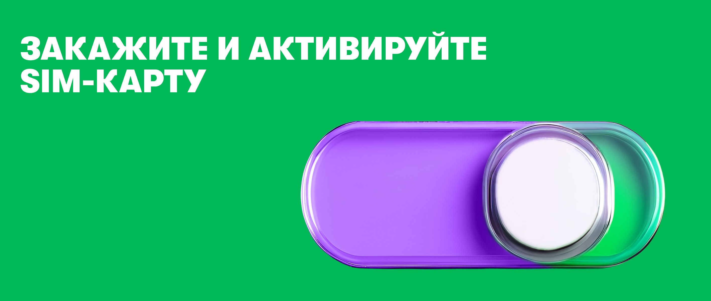

# Две SIM и близкие номера: совместная ценность, самостоятельные условия

## Выбор методов и статус результата

Выбраны проверка зависимости изображений, семиотика совместности, личные и общие роли, денежная область, путь двух подключений и описательный коммерческий контраст. Результат — различимые ветви самостоятельного и семейного использования. Одинаковые изображения не ранжируются заново по разным заказам; причинный эффект и юридическая общность продавцов не предполагаются.

[Все разборы и маршруты](../ОТКРЫТЬ.html)

## Что продаётся и почему это не одна семейная ставка

Сопоставлены два комплекта МегаФона на Ozon: 1614509709 для Санкт-Петербурга и области и 1656554183 для Москвы и области. В каждом сохранено 33 файла: десять изображений галереи и шесть подробных баннеров, текст и сведения наблюдения. Все 16 изображений совпадают побайтово по соответствующим позициям. Текстовые условия каждой карточки изучены отдельно.

Покупателю предлагаются две независимые SIM с номерами, отличающимися одной цифрой. Можно выбирать тариф каждой SIM, регистрировать на одного или разных людей; дополнительно предлагается семейная группа. Это несколько связанных ценностей: два носителя в одной покупке, удобство близких номеров, самостоятельность тарифа и возможность совместного использования пакетов. Они не равны одному подтверждённому тарифу семьи с фиксированной общей ценой.

Предлагается сохранить выразительную идею «на двоих», но показать две понятные ветви: самостоятельные тарифы либо участие в подходящей семейной группе. Приоритетная доработка должна раскрыть плательщика и ресурсы каждой ветви, цену носителей и деньги активации. Цель состоит в двух полезно подключённых SIM в подходящей задаче, а не просто в росте заказов парной упаковки.

## Главная сцена: как люди, транспорт, траектория и цифры образуют сообщение

Вверху расположен бренд, затем «Комплект SIM-карт на двоих», пояснение о различии номера в одну цифру и две SIM в упаковке. Фиолетовая плашка с молнией выделяет «Безлимиты бесплатно». В нижней части мужчина и женщина сидят рядом в фантастическом открытом транспорте с яркими задними соплами. Он движется по бирюзовому рельсовому пути, поднимающемуся к правому краю; рядом на прозрачной панели показаны окончания 23-24 и 23-25.

Описание «пара в автомобиле» сохранило бы людей, но потеряло конструкцию движения. Здесь нет обычной дорожной поездки. Сопла, стилизованный корпус и восходящий рельсовый путь создают фантастическую совместную поездку с динамикой. Направление траектории ведёт к области цифровой панели. Это композиционная связь сцены и номеров, а не наблюдение движения взгляда посетителя.

Близость номеров показана непосредственно различием последних цифр. Два пассажира представляют двух пользователей; общая поездка даёт образ отношения между ними. Вместе эти элементы позволяют прочитать комплект как связь двоих в общем действии. Поэтому изображение делает самостоятельную работу: две отдельные SIM без сцены объяснили бы количество, но слабее раскрывали бы совместную ценность.

Есть несколько уровней прочтения. Подпись прямо закрепляет двоих и близкие номера. Совместное движение поддерживает образ совместного пользования. Фантастический транспорт и молния допускают темы энергии, возможностей и лёгкого старта. Но измеренная скорость сети, быстрота регистрации или гарантированное удовольствие из сцены не следуют. Романтическая пара является одной представленной ситуацией; она не устанавливает, что покупатели являются супругами или что комплект предназначен только им.

Сильная альтернатива сложному переносу: это привлекательная сцена развлечения в фирменных цветах. Она объясняет фантастичность без необходимости видеть метафору общего тарифа. В пользу предметного отношения работают именно два пассажира, слово «на двоих» и два близких номера. В пользу свободного оформления работают отсутствие изображённого платежа и условность транспорта. Следовательно, образ совместности поддержан, а единый счёт или бесплатная связь обоих остаются неподтверждёнными.

## Два человека с телефонами: уточнение и расширение обещания

В первом подробном баннере мужчина и женщина уже стоят рядом, каждый смотрит в собственный телефон. Одинаковые фиолетовые вещи объединяют их в группу, разные аппараты сохраняют самостоятельность пользователей. Текст закрепляет парные номера и «две SIM-карты по цене одной». Ниже предлагает вступать в «МегаСемью» и не платить за связь.

Смена сюжета полезна: первый кадр продаёт совместную возможность, этот показывает повседневное использование двумя людьми. Улыбки являются изображёнными выражениями, но не свидетельствами удовлетворения реальных абонентов. Графика не доказывает и независимость договоров; это устанавливается собственным описанием.

Фраза «не платите за связь» требует роли. В [московском описании](../sources/1656554183/description.txt) говорится, что участники используют пакеты другого участника группы, который делится тарифом. Следовательно, отсутствие отдельной оплаты у присоединённого пользователя не делает бесплатной всю группу. Одного слова «семья» недостаточно, чтобы понять организатора, доступный пакет, условие присоединения и возможные дополнительные расходы.

Усиление: показать схему с двумя отдельными SIM и двумя ветвями. Первая: у каждого свой тариф и своя плата. Вторая: при подходящих условиях один организатор делится пакетами с участником; собственные роли и деньги подтверждаются владельцем продукта. Такая схема сохраняет совместность и самостоятельность одновременно. Она сильнее ещё одной общей фотографии счастливой пары, если задача состоит в выборе модели подключения.

## Подарок, молния и бесконечность обозначают разные вещи

[Кадр 3](../sources/1656554183/Gallery/G03.jpg) предлагает «до 120 ГБ в подарок» и показывает коробку с лентой. Коробка представляет подарок по привычному предметному признаку; текст устанавливает, что речь идёт о ресурсе, а не о физическом предмете в посылке. «До» сохраняет верхнюю границу. Без условий назначения нельзя обещать каждому 120 ГБ или делить их поровну на два номера.

В [подробном баннере 4](../sources/1656554183/Rich/R04.jpg) три условных фигуры представляют группу, а текст уточняет бонусные гигабайты в месяц. Это уже другая пространственная операция: центральный и боковые силуэты организуют множество участников. Но размер фигур не определяет доли ресурса и не устанавливает, кто платит. Эти отношения нужна показать текстом или схемой с подписанными ролями.

Молния повторяется возле «безлимитов», «МегаСил» и на объёмной пластине в [кадре 4](../sources/1656554183/Gallery/G04.jpg) и [кадре 6](../sources/1656554183/Gallery/G06.jpg). Она связывает несколько элементов в семейство дополнительных возможностей. Тема энергии и усиления поддержана словом «МегаСилы» и призывом улучшить тариф. Однако это не измерение мощности или скорости; точный предмет каждой возможности задаёт подпись.

Бесконечность на [баннере 5](../sources/1656554183/Rich/R05.jpg) соседствует с группами сервисов: социальные сети, мессенджеры, видео, музыка и кино, звонки внутри сети. Значок обобщает отсутствие лимита, но каждая группа имеет свой предмет. Безлимитный трафик к сервису не означает оплаченную подписку на его контент. Логотип кинотеатра не подтверждает доступ к платной библиотеке. Требуется сохранить область и условия каждого обещания.

## Переключатель: образ лёгкого действия и настоящая последовательность

Последний баннер показывает большой объёмный переключатель под «Закажите и активируйте SIM-карту». Светлая круглая часть находится справа на зелёно-фиолетовом основании. По сходству с интерфейсом это знак включения. Он сводит несколько будущих действий к одному простому образу и завершает сообщение активным глаголом.

Такой приём может быть уместным побуждением к следующему шагу: он задаёт цель, а не длинную инструкцию в финальном баннере. Но в комплекте присутствуют получение, регистрация, выбор тарифа, подтверждение личности и пополнение. Поэтому переключатель не доказывает активацию в одно нажатие. Также он остаётся картинкой: действительность нажатия и перехода площадки не проверена.

Проект усиления: рядом с призывом коротко назвать ближайшее действие и дать путь к подготовке, например «Выберите комплект для своего домашнего региона. После получения зарегистрируйте каждую SIM и выберите её тариф». Это не добавляет фиктивную кнопку. Если в канале доступна настоящая ссылка или управление, его реализуемость проверяется отдельно. Для инструкции нужно собственное подтверждение ветвей и денег.

## Что заставляет покупателя вычислять и сопоставлять

[Кадр 2](../sources/1656554183/Gallery/G02.jpg) показывает пополнение 300 рублей и кошелёк, поясняя использование денег на связь. Но для двух независимых SIM критичен охват: 300 на каждую или на комплект? Полученный текст использует единственное число «SIM-карты» и не позволяет безопасно получить общий денежный вход семьи. В московском описании дополнительно сказано, что после активации остаётся 150 рублей. В петербургском такого утверждения нет. Отсутствующее значение нельзя заменить нулём или перенести из другой карточки.

На кадре 4 две SIM продаются по цене одной; в наблюдениях цены комплектов 188 рублей для Москвы и 226 для Санкт-Петербурга. Эти цены относятся к покупке носителей, а не к будущим тарифам. Чтобы получить общий расход, нужно знать ветвь каждого абонента, область пополнения, абонентскую плату и порядок первых 30 дней. Простая сумма «цена комплекта плюс 300» пока не обоснована.

Когнитивное затруднение находится не в количестве слов само по себе. Человеку нужно различить количество носителей, число договоров, близость номеров, условия семейной группы, плательщика и два режима списания. Если эти отношения представлены только в разных кадрах и вопросах, требуется удерживать их до сопоставления. Предлагаемая схема двух ветвей выносит отношения наружу. Это экспертное облегчение задачи, а не измеренное снижение ошибок.

В [кадре 5](../sources/1656554183/Gallery/G05.jpg) названия тарифов показаны как перекрывающиеся вкладки и сопровождаются «Выбери любой». Они предлагают возможность выбора, но не содержат сравнительной цены и ресурса. В описании встречается другой перечень. Поэтому баннер не является готовым сравнением вариантов. Лучше связать выбор с задачей: самостоятельные телефоны, устройство с определённым расходом, участник группы. Только после этого сравнивать конкретные подтверждённые тарифы.

## Активация, помощь и последовательность

[Кадр 7](../sources/1656554183/Gallery/G07.jpg) даёт пять действий приложения и две ветви подтверждения личности. [Кадр 8](../sources/1656554183/Gallery/G08.jpg) показывает подготовку в четырёх нумерованных плитках; «или» связано с частью списка, а смартфон остаётся общим условием. Как и в годовом комплекте, сетка визуально уравнивает вещи разного логического статуса. Следует разделить общую подготовку и альтернативы, подтвердив собственный порядок этого продукта.

В описании обе SIM можно оформить на одного или разных людей. Это меняет задачу выполнения: комплект нельзя считать полностью подключённым после первой активации. Отдельно необходимо определить, когда присоединяется второй пользователь и какая ветвь выбрана. Если человек покупает близкие номера ради пары, но переносит прежний номер на одну SIM, нужно подтвердить, что остаётся от исходного преимущества близости. Источник разрешает перенос, но не устанавливает сохранение пары после замены номера.

Кадры 9–10 возвращают к помощи и официальному магазину. Поддержка предлагается перед отзывом, а общий знак обещает постоянную помощь. Эти сообщения способны поддерживать восстановление процесса, но реальный срок и результат не установлены. В будущем сопровождении нужно отличать первый подключённый номер, второй номер и семейную группу. Так рекомендация становится процессом продажи двух полезных подключений, а не призывом «усилить поддержку».

## Два региональных результата: что можно и чего нельзя заключить

В [коммерческом файле](../sources/Продажи.xlsx) строка 985 содержит пять заказанных петербургских комплектов, строка 885 — 29 московских за обозначенные источником 28 дней. Это товары-комплекты, не люди, оплаты или активированные SIM. Петербургская строка имеет 18918 показов и 701 переход, московская 27031 и 1045. Дни отсутствия на складе различаются: 20 из 28 против нуля; средняя цена заказа 124 против 101 рубля. Цена наблюдения и средняя цена периода не являются одной величиной.

Одинаковые 16 изображений не позволяют назвать их причиной разницы результата. Но не позволяют и доказать, что они не влияют: эффект может зависеть от региона, спроса и окружения, а доступность товара меняется одновременно. Нельзя просто разделить пять заказов на восемь предполагаемо доступных дней, потому что дневные экспозиции и смысл складского показателя не раскрыты. Неизвестная непрерывность версии дополнительно ограничивает объяснение изображения за период.

Содержательный результат сравнения: общая визуальная практика оценивается одинаково при одинаковом вопросе, а регион, наличие и денежная область сохраняются отдельно. Приоритет коммерческого разбора Петербурга начинается с доступности и спроса в его домашнем регионе, а не с назначения «плохой» общей картинки. Это не отменяет общей доработки ролей и денег для обоих комплектов.

## Решения и варианты модели продажи

Сохранить близость номеров, двух пользователей и самостоятельность SIM. Развить два проекта подачи: «близкие номера для двоих» и «две независимые SIM с возможностью общего ресурса при своих условиях». В первом главным становится запоминаемость и связь пары; во втором организация подключения. Общий будущий макет должен сохранять различие тарифной платы и цены носителей, область бонуса, верхнюю границу «до» и роли семейной группы.

Для проверки не смешивать одновременно новый главный образ, тариф, цену и складское наличие, если нужно выделить действие одного вмешательства. Если внедряется весь новый способ подачи, вывод относится пакету. Полезный исход можно определить как оплаченную и полученную упаковку с двумя завершёнными подходящими подключениями; для ветви семьи отдельно установить организатора, участника и использование нужного ресурса. Пока соответствующих журналов нет, такой показатель является проектом.

Все изображения получили собственную функцию: сцена пары; денежное начало; подарок; независимость; выбор тарифа; дополнительные возможности; активация; подготовка; помощь; авторитет; повседневная пара; повтор выбора; ассортимент; групповая выгода; области безлимита; побуждение к действию. [Баннер 3](../sources/1656554183/Rich/R03.jpg) показывает также другие предложения для роутеров, детей и устройств. Это ассортимент, а не включённые в упаковку продукты. Целостное решение сохраняет эту многослойность, но помогает выбрать конкретный путь вместо достраивания единой «бесплатной семьи».
