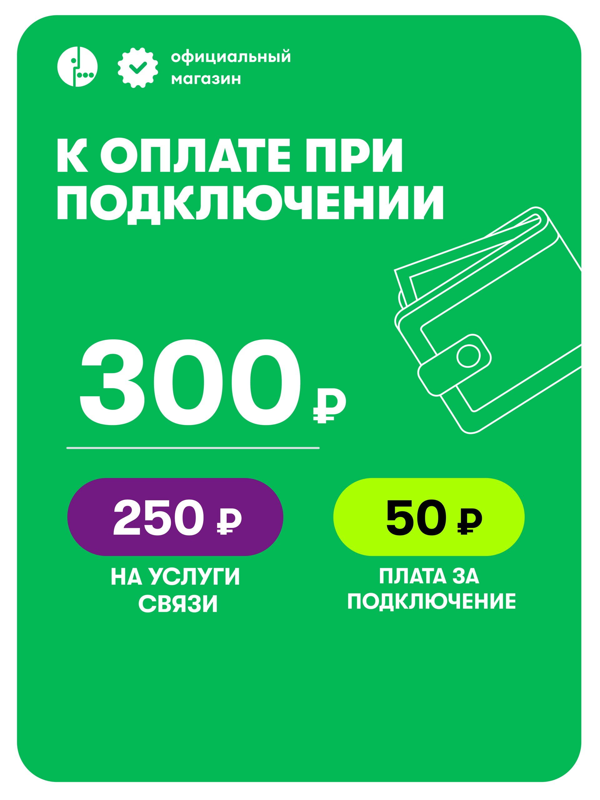

# Два контрастных предложения: какие практики переносить и почему

## Выбор методов и статус результата

Выбраны сравнение одной функции подачи, контраст разных предложений, аргументация, точность услуг и анализ визуальных знаков. Результат — перенос полезной функции с собственными условиями целевой карточки. Методы общего ценового ранга и причинного выбора победителя не активируются: продукты и контекст различаются.

[Все разборы и маршруты](../%D0%9E%D0%A2%D0%9A%D0%A0%D0%AB%D0%A2%D0%AC.md)

## Что сопоставляется

Сопоставлены МегаФон 2 ГБ с минутами, Ozon 1615293490, и Билайн 10 ГБ у «ТВОЙ БЕЗЛИМИТ», Ozon 4451881531. Сохранённые наблюдения относятся к 25 сентября 2026 года. Изучены 24 и 31 файл, в том числе все семь и четырнадцать изображений. Это контраст функций и моделей, а не эксперимент с одинаковыми товарами.

МегаФон предлагает 2 ГБ, 100 минут и 100 SMS за 200 рублей в месяц; после пакета интернет продолжается на 64 Кбит/с. Билайн предлагает 10 ГБ и 60 SMS за 150 рублей в месяц, исходящие по 3 рубля за минуту и бесплатную раздачу включённого ресурса. Цена носителя в обоих сохранённых комплектах 2 рубля с собственной подтверждённой валютой. Но денежный запуск, режим голосовой услуги и ограничения расхода различаются.

Результат сравнения: стоит переносить функции ясного объяснения, а не чужие суммы и привлекательные ярлыки. У МегаФона полезен ранний разбор пополнения; у Билайна подробная предметная структура услуг и выразительная единая иерархия. Одновременно оба материала показывают, почему стиль и убедительность нельзя оценивать без области обещания и процесса исполнения.

## МегаФон: деньги представлены как целое и части

Кадр 2 расположен сразу после главного пакета и говорит о сумме при подключении. Крупные 300 рублей находятся выше двух меньших плашек: 250 на услуги связи и 50 за подключение. Линия и вертикальная организация отделяют общий уровень от частей. Кошелёк принадлежит денежной теме; он не доказывает возврат средств. Здесь важнее не метафорическая сложность, а графическая структура одного платежа.

Преимущество перед поздней длинной строкой состоит в вынесенном наружу отношении 300 = 250 + 50. Читателю не требуется решать, складывать ли все три числа. Переносится именно эта операция. Для Билайна 5 ГБ нужны собственные 250 = 150 + 100 и собственный момент, а не скопированные 300 рублей.

При этом весь денежный путь МегаФона нельзя считать окончательно ясным. В [описании](../sources/1615293490/description.txt) после активации обещано зачисление суммы абонентской платы за 30 дней; стартовый баланс в характеристиках нулевой. Нужно установить отношение обещанного зачисления к 250 рублям услуг и будущим списаниям. Удачная композиция одной суммы не подтверждает весь денежный механизм.

Главный [кадр 1](../sources/1615293490/Gallery/G01.jpg) объединяет ресурсы на фиолетовом поле, а 200 рублей выделяет лаймовой плашкой у границы блока с подписью «в месяц». Контур часов представляет класс применения и частично выходит за ресурсный блок. Это связывает пакет с устройством без утверждения, что сами часы входят в покупку. На [кадре 3](../sources/1615293490/Gallery/G03.jpg) четыре категории техники оформлены равными плитками: полезная операция перечисления, но не подтверждение любой модели.

Формулировка «безлимитный интернет даже после пакета» сильна только со скоростью 64 Кбит/с рядом. Иначе сохраняется слово, а исчезает характеристика, которая меняет пригодность для камеры или видео. В этом кейсе низкоскоростное продолжение может быть преимуществом для отдельных сообщений; его достаточность для реального устройства не установлена. Нельзя объявить этот тариф безусловно лучше конечных пяти гигабайт другого предложения.

## МегаФон: условие, инструкция и реальное завершение

Кадр 4 показывает подготовку и возраст 14+; кадр 5 нумерует действия приложения и разделяет подтверждение активным номером и Госуслугами с Госключом. Иллюстрация смартфона с линией к щиту и галочке создаёт образ подтверждения. Она не является журналом успешной идентификации.

В описании номер задан упаковкой и не выбирается при заказе; в инструкции показан подбор номера позднее в приложении. Различие моментов допускает совместимость этих сообщений. Поэтому нельзя механически отметить противоречие, не различив заказ и регистрацию. Доступность конкретного номера остаётся неизвестной. Самостоятельная смена тарифа тоже не сохраняет автоматически прежнюю цену или включённые условия.

Кадр 6 направляет сначала в чат при проблемах доставки или товара, кадр 7 обещает помощь с активацией. В описании есть иной путь, группа ВКонтакте. Нужно показать актуальный доступный канал для нужной задачи и восстановление конкретного этапа. Логотип и слово «официальный» сохраняются как заявления источника. В наблюдении для московского контекста указана недоставка в регион; это конкретная доступность данного снимка, а не вечное отсутствие товара повсюду.

## Билайн 10 ГБ: динамика и цена раньше ресурса

Главный кадр начинается с очень крупного 150, рядом рубль и месячная единица. Ниже диагональная жёлтая плашка «Можно со своим номером», затем 10 ГБ и 60 SMS в двух отдельных блоках. Справа молодой мужчина в тёмной одежде с жёлтыми светящимися очками. Диагональные световые линии и контровое освещение повторяют его цветовой акцент.

Человек не изображает конкретную операцию использования SIM. Очки и свет создают технологический стиль и динамику, но не показывают быстроту сети. В сравнении с пчелой малого пакета это иной способ представить предложение: более человеческий образ и подчёркнутое движение вместо персонажа для техники. Возможное изменение идентификации аудитории остаётся гипотезой; по внешности героя нельзя вывести реальную целевую группу покупателей.

Цена и перенос номера получают больший композиционный вес, чем объём. Это может поддерживать вход через расход и сохранение привычного номера. Но символ рубля и «в месяц» должны оставаться вместе с 150 при уменьшении. Большое число без своей единицы создаёт уже другое сообщение. Период и сохранение номера нельзя переносить из этого кейса в другую карточку без собственных условий.

На [кадре 14](../sources/4451881531/Gallery/G14.jpg) стиль резко меняется: белый фон, чёрные числа на жёлтых прямоугольниках, предметные часы, планшет и роутер. Он повторяет ту же ресурсную модель без героя. Различие стиля не доказывает дефект; здесь можно сравнить функции двух подач. Первая продаёт вход через цену и динамичный образ, вторая поясняет пакет и категории техники. Вопрос состоит в согласованности обещаний и читаемом переходе, а не в обязательной одинаковости каждого фона.

## Слова и символы нельзя оценивать раздельно

[Кадр 3](../sources/4451881531/Gallery/G03.jpg) утверждает 150 рублей «навсегда», «без повышений», «без мелкого шрифта». Эти формулы закрывают будущую неопределённость сильнее обычной текущей ставки. Рядом изображены монеты и восходящая стрелка. Она может означать финансовую выгоду или рост ценности, но направление вверх возле денег допускает и рост суммы. Условие неизменности не доказывается этим символом. Содержательное усиление требует основания срока и изменения тарифа; без него «навсегда» не переносится в новый макет как проверенный факт.

На [кадре 6](../sources/4451881531/Gallery/G06.jpg) ракета находится рядом с «быстрым интернетом» и максимальной доступной скоростью. Здесь перенос скорости поддержан текстом сильнее, чем в изолированном декоративном рисунке. Но реальную скорость ракета не измеряет. Слово 5G в том же кадре является заявлением своего сохранённого материала, а не подтверждением сегодняшнего режима сети.

На [кадре 7](../sources/4451881531/Gallery/G07.jpg) заголовок «Безлимитный интернет» и знак бесконечности на смартфоне обобщают тему, а два внутренних блока ограничивают её мессенджерами и соцсетями по собственным 50 рублям в месяц. Логотипы обозначают сервисы, не одинаковое содержимое подписок. В описании опция названа одной строкой, поэтому цена одновременного подключения обеих ветвей требует согласования. Нельзя выбрать самое выгодное прочтение по рисунку.

[Кадр 8](../sources/4451881531/Gallery/G08.jpg) полезно уточняет, что для раздачи доступен весь включённый объём. Роутер с улыбающимся лицом олицетворяет устройство; знак Wi-Fi связывает его с функцией. Это иллюстрация доступного режима, а не доказательство «любого устройства без ограничений» из другого блока. Уместно перенести функцию точного ограничения объёмом, сохранив собственный пакет.

## Подробные услуги, поддержка и денежное начало

Кадры 4 и 5 раздельно объясняют звонки и SMS. Трубка обозначает голосовую услугу, конверт сообщение; направления входящего и исходящего даны собственным текстом. Входящие бесплатны по своему заявлению, исходящие 3 рубля за минуту. Это не безлимитные звонки вообще. Разделение двух направлений полезнее общей иконки телефона без подписи.

Кадр 2 даёт категории устройств, кадр 9 объединяет территорию, универсальность и регистрацию, кадр 10 — приложение, eSIM и выбор номера, кадр 11 — защиту, оплату сервисов и поддержку при нуле. Крупные однотипные жёлтые плитки образуют узнаваемую систему, но равная форма сама не устанавливает равную доказанность всех преимуществ. Щит с гарнитурой объединяет безопасность и помощь, хотя это разные процессы. Оплата сервисов не означает бесплатного контента.

Кадр 12 предлагает новый номер, перенос и выбор региона. Кадр 13 обещает самостоятельную активацию за пять минут и говорит о плате тарифа плюс 110 рублей. В [описании](../sources/4451881531/description.txt) денежный старт 260 рублей разложен на 150 за 30 дней, 100 за активацию и 10 возможной банковской комиссии. Будущая регулярная плата 150 в месяц. Возможная комиссия, её получатель и фактическое списание требуют уточнения; нельзя превратить её в обязательный доход оператора или магазина. Обещанные пять минут не являются наблюдаемым временем выполнения.

## Что действительно переносится в модель продажи

Из первого кейса переносится раннее объяснение денежного целого и частей. Из второго — предметная раздельность услуг, ресурсная конкретность и возможность связать цену с сохранением номера там, где перенос действительно доступен. Из обоих сохраняются полезные повторения в момент инструкции. Не переносятся чужие цены, возраст, возможности смены и скорость исполнения.

Для малого пакета 5 ГБ полезно разработать два варианта: под функцию устройства и под предсказуемый регулярный расход с явным запуском. Для 10 ГБ можно развить выбор по объёму, цене голосовых вызовов и переносу номера. Для 2 ГБ с минутами — по малому трафику, голосовой потребности и низкоскоростному продолжению. Это разные предложения; единый победитель по красоте или месячной ставке не нужен.

В коммерческой строке 180 у Билайна 10 ГБ 1159 заказанных единиц, 577187 показов, 14946 переходов, 16 дней отсутствия, 26 дней продвижения за обозначенные 28 дней. У малого пакета 497 единиц и 126247 показов. Большее число заказов при большем охвате не доказывает преимущество героя, ракеты или формулировки «навсегда». У МегаФона 2 ГБ сопоставленной строки нет; отсутствие строки не ноль.

Обоснованное решение состоит в выборе полезных функций подачи, адаптации под свой продукт и проверке подходящих оплаченных подключений и денежных результатов. Все 21 изображение двух кейсов рассмотрены, включая повторный главный вариант. Эти выводы являются открытым экспертным разбором; нового слепого согласия, реакции людей и коммерческого эффекта они не устанавливают.
